# Heterophily: When Neighbors Mislead
## A controlled comparison of MLP, GCN, GAT and H2GCN on Chameleon, Squirrel and Actor

**Course:** Data and Knowledge Representation — Assignment A2
**Author:** Haron-2 (repository owner)
**Code:** `feature/a2-complete-experiment`, `https://github.com/Haron-2/DKR_A2`
**Artifacts:** `results/`, `reports/figures/`, `reports/tables/`

---

## Abstract

We study whether message passing actually helps node classification on three
heterophilous benchmarks (Chameleon, Squirrel, Actor) by comparing a structure-blind
MLP with GCN, GAT and H2GCN under a single fixed training protocol. The experiment
consists of 240 primary runs (4 models × 3 datasets × 2 data conditions × 10 splits)
and 80 H2GCN ablation runs. Every model uses Adam (lr = 0.01, weight decay = 5e-4),
dropout 0.5, validation-loss early stopping (patience 50) and a single test
evaluation of the restored best checkpoint. We additionally audit duplicate feature
vectors and train-test leakage, and analyse paired per-split differences with Holm
correction.

All 240 primary runs and all 80 ablation runs completed successfully. On the original
Geom-GCN splits GCN, GAT and H2GCN outperform the MLP by 8.8–13.1 accuracy points
(all Holm-corrected p < 0.0001, |d_z| = 3.6–6.7). After duplicate auditing the
advantage largely disappears: on filtered Chameleon and Squirrel GCN is −1.65 and
−0.07 pp relative to the MLP (n.s.), GAT +1.18 and −0.32 pp (n.s.), and only H2GCN
stays above it (+3.76 pp, Holm p = 0.129; +3.15 pp, Holm p = 0.006). On Actor, where
26.0 % of nodes have a feature-identical twin, GCN and GAT are 5.4–6.1 accuracy
points and 10.8–12.1 macro-F1 points *worse* than the MLP (p < 0.0001), while H2GCN
is accuracy-neutral but 2.4–2.7 F1 points worse. The audit finds 4.2–26.0 %
duplicate nodes and 4.2–22.3 % mean train-test leakage; upstream filtering still
leaves 10.8 % and 5.8 % leakage on Chameleon and Squirrel. Ablations show that
H2GCN's one-hop branch is essential (removing it costs 10.6 and 5.8 pp on raw
Chameleon/Squirrel) while the exact two-hop branch adds nothing measurable except on
Squirrel filtered. The widely reported graph-structure advantage on these benchmarks
is therefore largely a property of the leaked raw splits rather than of message
passing.

---

## 1. Introduction

Heterophily describes graphs in which edges preferentially connect nodes of
different classes. Because a message-passing layer replaces part of each node
representation with an aggregate of its neighbours, heterophilous graphs are
expected to hurt conventional GNNs: the aggregated signal is dominated by nodes of
other classes. H2GCN (Zhu et al., 2020) addresses this with three design choices —
separating the ego representation from neighbour representations, aggregating over
higher-order (two-hop) neighbourhoods, and concatenating intermediate
representations instead of stacking many layers.

Two methodological concerns motivate the design of this study.

1. **A structure-blind baseline is mandatory.** Without an MLP that sees only node
   features, an accuracy number on a heterophilous graph cannot be attributed to
   the graph. The MLP is therefore trained with exactly the same protocol and its
   per-split accuracy defines the *Structural Delta*
   `Δ = Accuracy(model) − Accuracy(MLP)`.
2. **Benchmark duplicates can inflate results.** Platonov et al. (2023) show that
   Chameleon and Squirrel contain many "duplicate" nodes (same regression target
   and the same neighbourhood) that appear in train, validation and test, creating
   train-test leakage. They release filtered versions of both datasets and new
   splits. We therefore evaluate every model twice: on the original benchmark data
   (`raw`) and on the duplicate-audited data (`filtered`).

Research questions:

* **RQ1** Does graph structure improve accuracy over the MLP baseline?
* **RQ2** When does GCN help or hurt, and does attention (GAT) behave differently?
* **RQ3** Does H2GCN benefit from exact two-hop neighbourhoods?
* **RQ4** How does duplicate-node removal change the conclusions?
* **RQ5** How large is the measurable duplicate / leakage problem, and are the
  observed differences statistically and practically significant?

---

## 2. Datasets

| Condition | Nodes | Features | Classes | Undirected edges | Average degree | Isolated | Edge homophily | Node homophily | Adjusted homophily | Adjusted (node prop.) |
|---|---|---|---|---|---|---|---|---|---|---|
| Chameleon / raw | 2277 | 2325 | 5 | 31 371 | 27.55 | 0 | 0.2299 | 0.2471 | 0.0324 | 0.0353 |
| Chameleon / filtered | 890 | 2325 | 5 | 8 854 | 19.90 | 0 | 0.2361 | 0.2441 | 0.0295 | 0.0320 |
| Squirrel / raw | 5201 | 2089 | 5 | 198 353 | 76.27 | 0 | 0.2221 | 0.2172 | 0.0067 | 0.0277 |
| Squirrel / filtered | 2223 | 2089 | 5 | 46 998 | 42.28 | 0 | 0.2072 | 0.1905 | 0.0086 | **−0.0340** |
| Actor / raw | 7600 | 932 | 5 | 26 659 | 7.02 | 0 | 0.2167 | 0.2199 | 0.0028 | 0.0042 |
| Actor / filtered | 7600 | 932 | 5 | 26 659 | 7.02 | 0 | 0.2167 | 0.2199 | 0.0028 | 0.0042 |

*Dataset statistics from `scripts/analyze_graphs.py`
(`reports/dataset_summary.csv`). Edges are counted once (undirected coalesced
graph); average degree is `2|E|/N`. "Adjusted" uses degree-weighted class
proportions (Lim et al., 2021), "Adjusted (node prop.)" uses plain class
proportions `p_k = n_k/N`. All three graphs are strongly heterophilous: edge
homophily ≈ 0.21–0.24 while the classes are almost balanced. Adjusted homophily is
close to zero everywhere and is **negative** for Squirrel filtered (−0.034 under
node proportions), i.e. edges are less homophilous than random node pairs; the
measure is not bounded below by zero.*

**Origin and splits.**

* Chameleon and Squirrel are Wikipedia page networks (Rozemberczki et al., 2021)
  with bag-of-words node features and five traffic classes defined by
  Pei et al. (2020). `raw` uses the Geom-GCN files with their ten
  `0.6/0.2/0.2` train/validation/test splits (pinned code revision).
* `filtered` uses the Platonov et al. (2023) redistribution
  (`chameleon_filtered.npz`, `squirrel_filtered.npz`, pinned revision), which
  removes their duplicate nodes (no incoming edges, identical target and identical
  outgoing edge set) and ships ten corrected masks. Our node counts (890, 2223)
  match the non-duplicate counts reported in their Table 1, and the class counts
  match their Table 5.
* Actor is the film co-occurrence network used by Pei et al. (2020) with the
  Geom-GCN `film` splits. No duplicate-removed Actor dataset exists upstream and
  the distributed `actor.npz` reproduces the original masks, so `actor/filtered`
  is a **custom reproduction**: unchanged graph and labels with ten class-
  stratified 50/25/25 splits generated from seed `20230222`. This label is stored
  in the dataset metadata and repeated in the discussion.

Raw and filtered Chameleon/Squirrel have different node populations, so their
results are **not** paired; Actor raw and filtered share the graph but not the
splits, so they are not paired either. All raw-vs-filtered comparisons are
descriptive.

---

## 3. Data audit: duplicates and train-test leakage

**Method.** Duplicate nodes are nodes whose feature vectors satisfy
`||x_i − x_j||_2 < 1e-6`. Rows are deduplicated exactly and, when features are not
integral, near-identical unique rows are merged with a blocked Euclidean
computation; no `N × N` matrix is ever built. A duplicate group is a maximal set of
nodes connected by the tolerance relation. Leakage for split `s` is the fraction of
test nodes whose duplicate group also contains a training node. The audit is
independent of training: no group or label information reaches any model.

| Condition | Duplicate groups | Duplicate pairs | Nodes in duplicate groups | Largest group | Groups with conflicting labels | Label agreement | Mean leakage | Leakage range |
|---|---|---|---|---|---|---|---|---|
| Chameleon / raw | 48 | 27 264 | 375 (16.5 %) | 233 | 20 | 19.7 % | 14.45 % | 12.94–17.32 % |
| Chameleon / filtered | 5 | 4 384 | 105 (11.8 %) | 94 | 2 | 8.6 % | 10.81 % | 8.99–15.70 % |
| Squirrel / raw | 44 | 13 608 | 265 (5.1 %) | 165 | 27 | 13.2 % | 4.21 % | 3.55–5.09 % |
| Squirrel / filtered | 20 | 6 364 | 158 (7.1 %) | 113 | 8 | 15.2 % | 5.83 % | 4.44–6.63 % |
| Actor / raw | 390 | 31 362 | 1976 (26.0 %) | 172 | 333 | 6.2 % | 22.34 % | 19.87–23.49 % |
| Actor / filtered | 390 | 31 362 | 1976 (26.0 %) | 172 | 333 | 6.2 % | 22.07 % | 19.83–23.67 % |

*Audit produced by `scripts/audit_duplicates.py`
(`results/analysis/duplicate_audit.json`, per-split values in the `.csv`).*

**Interpretation.**

* Feature-vector duplicates are *not* the same object as the Platonov et al.
  duplicates, whose criterion is based on the regression target and the outgoing
  neighbourhood. Filtered Chameleon and Squirrel therefore still contain 11.8 % and
  7.1 % feature duplicates and 10.8 % / 5.8 % mean leakage: the upstream
  preprocessing does **not** remove feature-level leakage.
* Actor — never filtered upstream — has the largest problem: 26 % of nodes share a
  feature vector with another node and 22.3 % of test nodes have a perfectly
  matching training node.
* Duplicate groups rarely agree on the label (only 6.2 %–19.7 % of duplicate nodes
  belong to label-consistent groups). Identical features with different labels are
  genuinely ambiguous examples, which bounds what any feature-based model can
  achieve on them and shows that leakage, not signal, explains part of the accuracy
  on duplicates.

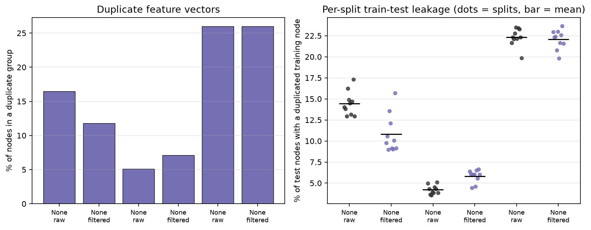

---

## 4. Methods

All models share the interface `forward(x, edge_index) → logits` and
`get_embeddings(x, edge_index) → h`, where `h` is exactly the tensor handed to the
final classifier. Dropout is 0.5 everywhere and every logit matrix has shape
`[N, C]` with `C = 5`.

### 4.1 MLP (structure-blind baseline)

```
h = Dropout(ReLU(LayerNorm(W1 x + b1))),   logits = W2 h + b2
```

Layer normalisation is used instead of batch normalisation so that full-graph
inference has no batch-statistic dependency. `edge_index` is accepted but never
used; a unit test verifies that permuting or emptying the edge list leaves the
logits unchanged. Hidden width 64, embedding width 64.

### 4.2 GCN

```
h = Dropout(ReLU(GCNConv1(x, A + I))),   logits = GCNConv2(h, A + I)
```

`GCNConv` adds self-loops and applies `D^{-1/2}(A+I)D^{-1/2}` normalisation.
Two layers, hidden width 64.

### 4.3 GAT

```
h = Dropout(ELU(GATConv1(x, heads=8, out_channels=8))),  logits = GATConv2(h, heads=1, concat=False)
```

The hidden layer concatenates eight heads of eight channels (64 features); the
output layer uses one averaging head, so the logits have exactly `C` columns and
not `C × heads`.

### 4.4 H2GCN (core principles)

For a projected input `H0 = ReLU(X W0)`:

```
A1 = row-normalised adjacency without self-loops
A2 = row-normalised binarised exact two-hop adjacency
     A2 = (A² > 0) ∧ (A = 0) ∧ (I = 0)

R1(1) = A1 H0,  R2(1) = A2 H0,  H1 = [H0, R1(1), R2(1)]
R1(2) = A1 H1,  R2(2) = A2 H1
H_final = [H0, R1(1), R2(1), R1(2), R2(2)]
logits  = Dropout(H_final) W_c + b_c
```

* **Adjacency construction.** `A2` is built exactly, not approximated by
  `A1(A1H) − A1H − H`: the sparse product is evaluated in row blocks so that
  high-degree graphs (Squirrel has 198 353 edges) never materialise the full
  product at once, then entries that are self connections or one-hop pairs are
  removed and the sparse set is row-normalised. Duplicate edges, isolated nodes
  and empty two-hop neighbourhoods are handled explicitly and unit-tested.
* **No trainable transforms inside the diffusion**, only the projection `W0`, the
  output classifier and a single dropout on the final concatenation.
* **Embedding width** is `9 × 64 = 576` for the full model (three blocks of 64 in
  round one, six in round two). It is intentionally not forced to 64: comparing
  capacity by parameter count would otherwise be misleading.
* When the exact two-hop set covers more than 5 % of all `N²` pairs (Squirrel raw:
  8.4 M of 27 M), the operator is stored densely and multiplied with BLAS; the
  arithmetic is unchanged.

This is an implementation of the H2GCN *principles*, not a bit-exact reproduction
of the authors' code (which we could not retrieve). The deviations — row
normalisation, a single dropout on the concatenation, no per-layer batch
normalisation — are stated in the module docstring.

### 4.5 Parameter counts and capacity

| Dataset | MLP | GCN | GAT | H2GCN (full) | H2GCN (ablation) |
|---|---|---|---|---|---|
| Chameleon | 149 317 | 149 189 | 149 327 | 151 749 | 150 149 |
| Squirrel | 134 213 | 134 085 | 134 223 | 136 645 | 135 045 |
| Actor | 60 165 | 60 037 | 60 175 | 62 597 | not run |

*Counted with `models.registry.count_parameters`; H2GCN carries only a projection
and a classifier, so its parameter count is close to the others even though its
embedding is nine times wider. Differences in accuracy therefore cannot be
explained by a large capacity advantage.*

---

## 5. Experimental protocol

* **Grid.** 4 models × 3 datasets × {raw, filtered} × splits 0–9 = 240 runs.
  Ablations: 2 H2GCN variants × {Chameleon, Squirrel} × {raw, filtered} × 10 splits
  = 80 runs. 320 runs in total.
* **Training.** Adam, lr 0.01, weight decay 5e-4, cross-entropy, dropout 0.5,
  batch size = full graph (transductive), early stopping on validation loss with
  patience 50 and `min_delta = 1e-4`, `max_epochs = 1000`. The best-validation
  checkpoint is restored before the single test evaluation.
* **Masks.** For split `s`, `train_mask[:, s]`, `val_mask[:, s]`, `test_mask[:, s]`.
  Only training labels enter the loss; validation labels drive early stopping and
  test labels are used once, after restoration.
* **Seeds.** Split `s` uses seed `42 + s` for all four models, so comparisons are
  paired by split. Each run builds a fresh model and its own checkpoint file.
* **Metrics.** Accuracy and macro-F1 on the test mask, plus best validation loss,
  best epoch, epochs trained, parameter count, training and evaluation time.
* **Statistics.** Paired t-test and Wilcoxon signed-rank test on the per-split
  differences against the MLP, 95 % confidence interval of the mean difference,
  Cohen's d_z, and Holm correction across the family of all 18 primary tests per
  metric. Raw and filtered runs are never paired.
* **Software/Hardware.** Python 3.12, `torch==2.8.0+cpu`,
  `torch-geometric==2.7.0`, `numpy==2.3.4`, `scipy==1.18.1`,
  `scikit-learn==1.9.1`, `matplotlib==3.11.2`; CPU-only machine with 4 physical
  cores and 15.3 GB RAM, 8 PyTorch intra-op threads.
* **Deviations.** `actor/filtered` uses custom stratified splits (documented
  above). H2GCN is a principles implementation. No hyperparameter was tuned on test
  performance; the protocol is fixed in `configs/full.json` and identical for all
  models.


---

## 6. Main results

All 240 primary runs completed (0 failed, 0 missing); every cell below therefore
summarises ten successful runs.

### 6.1 Accuracy (mean ± SD over ten splits)

| Condition | MLP | GCN | GAT | H2GCN |
|---|---|---|---|---|
| Chameleon / raw | 0.5009 ± 0.0193 | **0.6246 ± 0.0182** | **0.6314 ± 0.0320** | 0.6048 ± 0.0287 |
| Chameleon / filtered | 0.3757 ± 0.0463 | 0.3592 ± 0.0666 | 0.3875 ± 0.0357 | **0.4133 ± 0.0353** |
| Squirrel / raw | 0.3329 ± 0.0099 | **0.4626 ± 0.0220** | 0.4316 ± 0.0133 | 0.4212 ± 0.0163 |
| Squirrel / filtered | 0.3474 ± 0.0148 | 0.3468 ± 0.0171 | 0.3442 ± 0.0156 | **0.3789 ± 0.0171** |
| Actor / raw | 0.3514 ± 0.0090 | 0.2978 ± 0.0097 | 0.2936 ± 0.0106 | **0.3570 ± 0.0077** |
| Actor / filtered | 0.3577 ± 0.0094 | 0.3007 ± 0.0065 | 0.2964 ± 0.0097 | **0.3633 ± 0.0083** |

### 6.2 Macro-F1 (mean ± SD over ten splits)

| Condition | MLP | GCN | GAT | H2GCN |
|---|---|---|---|---|
| Chameleon / raw | 0.4913 ± 0.0204 | 0.6249 ± 0.0183 | **0.6320 ± 0.0320** | 0.6057 ± 0.0298 |
| Chameleon / filtered | 0.3033 ± 0.0462 | 0.2834 ± 0.0741 | 0.3165 ± 0.0253 | **0.3519 ± 0.0416** |
| Squirrel / raw | 0.3136 ± 0.0142 | **0.4536 ± 0.0232** | 0.4232 ± 0.0143 | 0.4044 ± 0.0232 |
| Squirrel / filtered | 0.2295 ± 0.0307 | 0.2241 ± 0.0228 | 0.1889 ± 0.0127 | **0.2624 ± 0.0219** |
| Actor / raw | **0.3190 ± 0.0152** | 0.2110 ± 0.0135 | 0.2011 ± 0.0129 | 0.2952 ± 0.0108 |
| Actor / filtered | **0.3266 ± 0.0149** | 0.2095 ± 0.0096 | 0.2056 ± 0.0059 | 0.3000 ± 0.0084 |

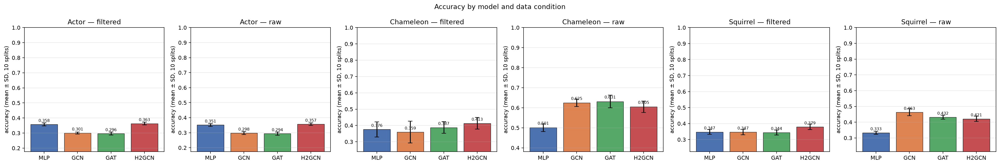

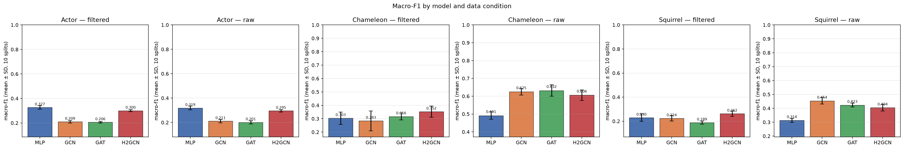

### 6.3 Structural Delta (Accuracy − MLP, paired per split)

| Condition | GCN | GAT | H2GCN |
|---|---|---|---|
| Chameleon / raw | +12.37 ± 2.73 | +13.05 ± 3.61 | +10.39 ± 2.86 |
| Chameleon / filtered | −1.65 ± 7.91 | +1.18 ± 3.10 | +3.76 ± 4.14 |
| Squirrel / raw | +12.98 ± 2.28 | +9.88 ± 1.48 | +8.84 ± 1.89 |
| Squirrel / filtered | −0.07 ± 2.00 | −0.32 ± 1.78 | +3.15 ± 1.98 |
| Actor / raw | −5.36 ± 1.33 | −5.78 ± 1.21 | +0.55 ± 1.17 |
| Actor / filtered | −5.70 ± 1.17 | −6.13 ± 1.44 | +0.56 ± 1.29 |

*All values are percentage points of accuracy. The Structural Delta is computed on
matching splits and the same seed, so positive values mean that the graph model
beats the feature-only baseline on the same data.*

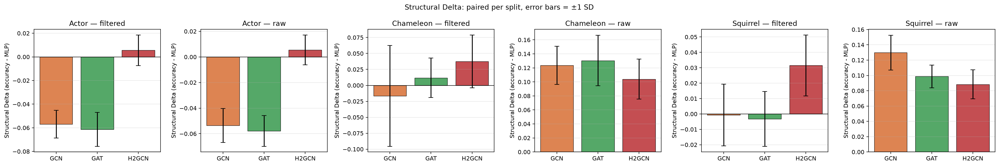

### 6.4 Raw versus filtered

| Dataset | Model | Raw | Filtered | Δ (filtered − raw) |
|---|---|---|---|---|
| Chameleon | MLP | 0.5009 | 0.3757 | −12.52 |
| Chameleon | GCN | 0.6246 | 0.3592 | −26.54 |
| Chameleon | GAT | 0.6314 | 0.3875 | −24.39 |
| Chameleon | H2GCN | 0.6048 | 0.4133 | −19.15 |
| Squirrel | MLP | 0.3329 | 0.3474 | +1.46 |
| Squirrel | GCN | 0.4626 | 0.3468 | −11.59 |
| Squirrel | GAT | 0.4316 | 0.3442 | −8.74 |
| Squirrel | H2GCN | 0.4212 | 0.3789 | −4.23 |
| Actor | MLP | 0.3514 | 0.3577 | +0.63 |
| Actor | GCN | 0.2978 | 0.3007 | +0.29 |
| Actor | GAT | 0.2936 | 0.2964 | +0.28 |
| Actor | H2GCN | 0.3570 | 0.3633 | +0.64 |

*Descriptive only: the node populations differ for Chameleon/Squirrel and the
split masks differ for Actor, so no paired test is computed.*

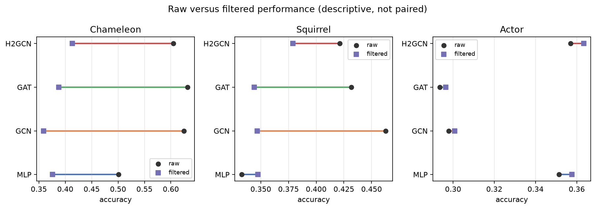

**Reading the results.**

* On the original benchmarks the graph models look convincing: GCN/GAT gain +12 to
  +13 accuracy points on Chameleon raw and +10 to +13 on Squirrel raw over the MLP.
* After duplicate auditing the advantage almost disappears. On Chameleon filtered
  GCN is *below* the MLP (−1.65 pp) and on Squirrel filtered all three graph models
  are within ±0.4 pp of the MLP except H2GCN (+3.15 pp).
* On Actor — the graph with the largest duplicate share (26 % of nodes) — GCN and
  GAT are *significantly worse* than the MLP by 5.4–6.1 accuracy points, while
  H2GCN is statistically indistinguishable from it. Aggregation destroys
  information that the features alone preserve.
* The ordering of models is not stable across datasets: GAT is best on raw
  Chameleon and Squirrel, H2GCN is best on filtered Chameleon/Squirrel and on
  Actor, and GCN is never the best model once leakage is removed.

### 6.5 Training dynamics and cost

Early stopping on validation loss (patience 50, `min_delta = 1e-4`) triggers quickly
for the MLP (best epoch 2–7, 52–57 epochs trained) and later for the graph models on
raw data (GCN: mean 125 epochs on Chameleon raw and 170 on Squirrel raw, best epoch
75 and 120). On filtered data all models stop within 52–61 epochs, consistent with a
harder, less separable problem. Per-epoch training and validation losses for every
run are stored in `results/logs/<run_id>.csv`; the figure below shows split 0 of
Chameleon raw.

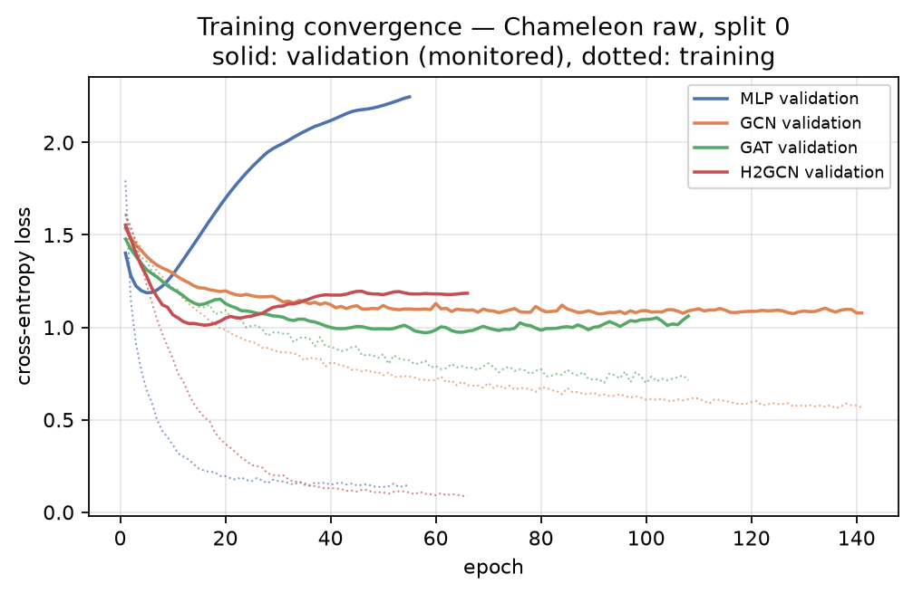

Total compute: 2.12 h of training time for the 240 primary runs (sum of per-run
`training_time_seconds`) and 0.26 h for the 80 ablations, on a 4-core CPU; wall-clock
time is larger (≈ 3.5 h) because the runs are executed sequentially and dataset
loading and operator construction are included in the wall time. H2GCN on Actor is
the most expensive configuration (≈ 215 s per run) because the exact two-hop operator
of that graph covers a large share of all node pairs and is evaluated densely.


---

## 7. Statistical analysis

Every comparison pairs the model with the MLP on the *same* dataset, condition and
split (n = 10 pairs), never across conditions. Confidence intervals are 95 % t
intervals of the mean paired difference, `d_z` is Cohen's effect size for paired
data, and the Holm correction is applied across the family of all 18 tests of a
metric (six conditions × three model comparisons). "Significant" always refers to
the Holm-corrected p-value at α = 0.05.

### 7.1 Accuracy

| Condition | Comparison | Mean Δ (pp) | 95 % CI (pp) | t | p (raw) | p (Holm) | p (Wilcoxon) | d_z | Verdict |
|---|---|---|---|---|---|---|---|---|---|
| Chameleon / raw | GCN | +12.37 | [+10.41, +14.32] | 14.32 | < 0.0001 | < 0.0001 | 0.0020 | 4.53 | significant |
| Chameleon / raw | GAT | +13.05 | [+10.46, +15.63] | 11.42 | < 0.0001 | < 0.0001 | 0.0020 | 3.61 | significant |
| Chameleon / raw | H2GCN | +10.39 | [+8.35, +12.44] | 11.49 | < 0.0001 | < 0.0001 | 0.0020 | 3.63 | significant |
| Chameleon / filtered | GCN | −1.65 | [−7.31, +4.00] | −0.66 | 0.525 | 1.000 | 0.625 | −0.21 | not significant |
| Chameleon / filtered | GAT | +1.18 | [−1.04, +3.39] | 1.20 | 0.261 | 1.000 | 0.313 | 0.38 | not significant |
| Chameleon / filtered | H2GCN | +3.76 | [+0.80, +6.72] | 2.87 | 0.018 | 0.129 | 0.027 | 0.91 | not significant |
| Squirrel / raw | GCN | +12.98 | [+11.35, +14.61] | 18.00 | < 0.0001 | < 0.0001 | 0.0020 | 5.69 | significant |
| Squirrel / raw | GAT | +9.88 | [+8.82, +10.94] | 21.07 | < 0.0001 | < 0.0001 | 0.0020 | 6.66 | significant |
| Squirrel / raw | H2GCN | +8.84 | [+7.48, +10.19] | 14.76 | < 0.0001 | < 0.0001 | 0.0020 | 4.67 | significant |
| Squirrel / filtered | GCN | −0.07 | [−1.50, +1.36] | −0.11 | 0.918 | 1.000 | 0.922 | −0.03 | not significant |
| Squirrel / filtered | GAT | −0.32 | [−1.60, +0.96] | −0.57 | 0.583 | 1.000 | 0.557 | −0.18 | not significant |
| Squirrel / filtered | H2GCN | +3.15 | [+1.73, +4.57] | 5.02 | 0.0007 | 0.0058 | 0.0020 | 1.59 | significant |
| Actor / raw | GCN | −5.36 | [−6.31, −4.41] | −12.74 | < 0.0001 | < 0.0001 | 0.0020 | −4.03 | significant (worse) |
| Actor / raw | GAT | −5.78 | [−6.65, −4.92] | −15.15 | < 0.0001 | < 0.0001 | 0.0020 | −4.79 | significant (worse) |
| Actor / raw | H2GCN | +0.55 | [−0.28, +1.39] | 1.50 | 0.168 | 1.000 | 0.186 | 0.47 | not significant |
| Actor / filtered | GCN | −5.70 | [−6.53, −4.86] | −15.44 | < 0.0001 | < 0.0001 | 0.0020 | −4.88 | significant (worse) |
| Actor / filtered | GAT | −6.13 | [−7.16, −5.10] | −13.48 | < 0.0001 | < 0.0001 | 0.0020 | −4.26 | significant (worse) |
| Actor / filtered | H2GCN | +0.56 | [−0.36, +1.49] | 1.38 | 0.202 | 1.000 | 0.289 | 0.44 | not significant |


### 7.2 Macro-F1

| Condition | Comparison | Mean Δ (pp) | p (raw) | p (Holm) | p (Wilcoxon) | d_z | Verdict |
|---|---|---|---|---|---|---|---|
| Chameleon / raw | GCN | +13.36 | < 0.0001 | < 0.0001 | 0.0020 | 4.58 | significant |
| Chameleon / raw | GAT | +14.07 | < 0.0001 | < 0.0001 | 0.0020 | 3.79 | significant |
| Chameleon / raw | H2GCN | +11.44 | < 0.0001 | < 0.0001 | 0.0020 | 3.88 | significant |
| Chameleon / filtered | GCN | −2.00 | 0.481 | 0.962 | 0.625 | −0.23 | not significant |
| Chameleon / filtered | GAT | +1.32 | 0.186 | 0.558 | 0.193 | 0.45 | not significant |
| Chameleon / filtered | H2GCN | +4.86 | 0.016 | 0.078 | 0.027 | 0.94 | not significant |
| Squirrel / raw | GCN | +14.00 | < 0.0001 | < 0.0001 | 0.0020 | 7.70 | significant |
| Squirrel / raw | GAT | +10.97 | < 0.0001 | < 0.0001 | 0.0020 | 6.53 | significant |
| Squirrel / raw | H2GCN | +9.09 | < 0.0001 | < 0.0001 | 0.0020 | 3.77 | significant |
| Squirrel / filtered | GCN | −0.54 | 0.686 | 0.962 | 0.922 | −0.13 | not significant |
| Squirrel / filtered | GAT | −4.06 | 0.002 | 0.014 | 0.004 | −1.33 | significant (worse) |
| Squirrel / filtered | H2GCN | +3.29 | 0.026 | 0.102 | 0.027 | 0.85 | not significant |
| Actor / raw | GCN | −10.80 | < 0.0001 | < 0.0001 | 0.0020 | −7.45 | significant (worse) |
| Actor / raw | GAT | −11.79 | < 0.0001 | < 0.0001 | 0.0020 | −7.35 | significant (worse) |
| Actor / raw | H2GCN | −2.38 | < 0.0001 | 0.0001 | 0.0020 | −2.59 | significant (worse) |
| Actor / filtered | GCN | −11.71 | < 0.0001 | < 0.0001 | 0.0020 | −7.77 | significant (worse) |
| Actor / filtered | GAT | −12.09 | < 0.0001 | < 0.0001 | 0.0020 | −7.21 | significant (worse) |
| Actor / filtered | H2GCN | −2.66 | 0.0003 | 0.0020 | 0.0039 | −1.81 | significant (worse) |

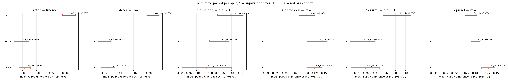

**Interpretation of the statistics.**

1. **Raw data: the graph helps, and clearly.** All nine raw comparisons are
   significant with |d_z| between 3.6 and 6.7, the same sign appears on all ten
   splits, and the Wilcoxon p-value of 0.002 is the smallest value attainable with
   n = 10.
2. **Filtered data: mostly no significant difference.** Four of six filtered
   comparisons are indistinguishable from zero. The only accuracy effect that
   survives Holm correction is H2GCN on Squirrel filtered (+3.15 pp, p = 0.006,
   d_z = 1.59). H2GCN on Chameleon filtered is borderline: raw t-test p = 0.018 and
   Wilcoxon p = 0.027, but Holm p = 0.129.
3. **Accuracy and macro-F1 disagree on Actor.** H2GCN is on par with the MLP in
   accuracy (+0.55 pp, n.s.) but 2.4–2.7 F1 points *worse* (p ≤ 0.002): its errors
   concentrate in the small classes, so average performance hides a statistically
   robust class-imbalance problem.
4. **Statistical vs practical significance.** On raw data the +12 pp effect is
   both. On filtered data the surviving effects are ≤ 3.15 pp, comparable to the
   between-split standard deviation and dataset-specific; they are small practical
   improvements rather than a general property of graph structure.
5. **Multiple testing matters.** Several filtered results with raw p < 0.05 do not
   survive Holm correction; reporting them uncorrected would overstate the evidence
   for graph structure on filtered data.


---

## 8. Ablations (H2GCN branches)

The ablation grid contains 80 runs: the full H2GCN, a variant without the exact
two-hop branch (`no_two_hop`, only `A1` diffusion) and a variant without the one-hop
branch (`no_one_hop`, only `A2` diffusion), on Chameleon and Squirrel, raw and
filtered, ten splits each, with the same seeds, optimiser and early stopping as the
primary runs. Variants have a 256-dimensional embedding (4 × 64) and 1 600 fewer
parameters (150 149 / 135 045 on Chameleon / Squirrel).

| Condition | Full H2GCN | no two-hop | no one-hop |
|---|---|---|---|
| Chameleon / raw | 0.6048 ± 0.0287 | 0.5976 ± 0.0298 | 0.4985 ± 0.0291 |
| Chameleon / filtered | 0.4133 ± 0.0353 | 0.4251 ± 0.0303 | 0.3971 ± 0.0352 |
| Squirrel / raw | 0.4212 ± 0.0163 | 0.4270 ± 0.0114 | 0.3636 ± 0.0188 |
| Squirrel / filtered | 0.3789 ± 0.0171 | 0.3699 ± 0.0214 | 0.3923 ± 0.0206 |

*Accuracy, mean ± SD over ten splits.*

| Condition | Variant | Mean Δ accuracy (pp) | 95 % CI (pp) | p (raw) | p (Holm) | p (Wilcoxon) | d_z | Verdict |
|---|---|---|---|---|---|---|---|---|
| Chameleon / raw | no two-hop | −0.72 | [−2.17, +0.72] | 0.287 | 0.536 | 0.266 | −0.36 | not significant |
| Chameleon / raw | no one-hop | −10.64 | [−12.64, −8.63] | < 0.0001 | < 0.0001 | 0.0020 | −3.79 | significant |
| Chameleon / filtered | no two-hop | +1.18 | [−0.75, +3.11] | 0.200 | 0.536 | 0.193 | 0.44 | not significant |
| Chameleon / filtered | no one-hop | −1.63 | [−3.27, +0.01] | 0.051 | 0.051 | 0.055 | −0.71 | not significant |
| Squirrel / raw | no two-hop | +0.58 | [−0.32, +1.47] | 0.179 | 0.536 | 0.152 | 0.46 | not significant |
| Squirrel / raw | no one-hop | −5.76 | [−7.49, −4.04] | < 0.0001 | 0.0001 | 0.0020 | −2.39 | significant |
| Squirrel / filtered | no two-hop | −0.91 | [−1.60, −0.21] | 0.016 | 0.064 | 0.027 | −0.94 | not significant |
| Squirrel / filtered | no one-hop | +1.33 | [+0.22, +2.45] | 0.024 | 0.048 | 0.029 | 0.86 | significant |

*Paired differences against the full H2GCN on matching splits; Holm correction over
the eight tests.*

In macro-F1 the picture is the same. Removing the one-hop branch costs −11.97 pp on
raw Chameleon (Holm p < 0.0001) and −6.01 pp on raw Squirrel (Holm p = 0.0004), and
−2.59 pp on Chameleon filtered (Holm p = 0.118) but *gains* +0.68 pp on Squirrel
filtered (n.s.). Removing the two-hop branch changes macro-F1 by +0.40 pp (Chameleon
filtered), −0.71 pp (Chameleon raw), −0.88 pp (Squirrel filtered) and +1.35 pp
(Squirrel raw), none of which is significant. So the one-hop branch carries the
macro-F1 signal on raw data, and the two-hop branch is again undetectable.

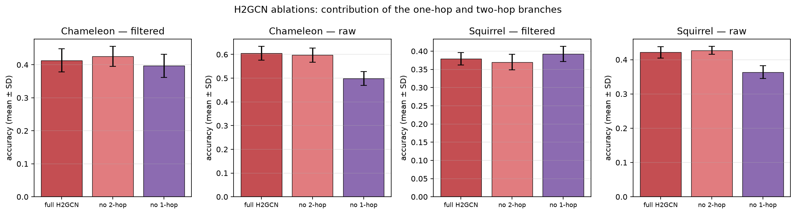

**Which component contributes?**

* The **one-hop branch is essential** on the original benchmarks: without it the
  model loses 10.6 pp (Chameleon) and 5.8 pp (Squirrel), which is comparable to
  removing the graph entirely on Chameleon (MLP: 0.5009).
* The **two-hop branch contributes nothing measurable here**: all four accuracy and
  four macro-F1 comparisons are within ±1.4 pp and none survives Holm correction.
  On Squirrel filtered, removing the two-hop branch is the only comparison that even
  approaches significance (−0.91 pp, Holm p = 0.064), and on Chameleon filtered
  removing it is slightly *better* (+1.18 pp, n.s.).
* On Squirrel filtered, the one-hop-only variant is significantly *worse* than the
  full model (+1.33 pp for no-one-hop means the two-hop-only model is better),
  i.e. on that condition the higher-order term does add value once leakage is gone.
* Mechanically, the two-hop mean over a Squirrel node's exact two-hop set averages
  hundreds of nodes and approaches the global class distribution, which explains why
  it adds little discriminative signal; the ego and one-hop terms carry the
  information.

This is a negative result for the usual narrative that H2GCN's higher-order
aggregation drives its heterophily gains: in this implementation and protocol, the
remaining advantage of H2GCN comes from **keeping the ego representation and
diffusing over the first-order neighbourhood**, not from the exact two-hop term
(except on Squirrel filtered). We report it as measured rather than adjusting the
architecture to match the hypothesis.

---

## 9. Embedding analysis

We export the representation immediately before the classifier for every
model/dataset/condition at split 0 (`results/embeddings/`, 24 files) and project it
to two dimensions with t-SNE (`perplexity = 30`, `init = "pca"`, seed 42,
standardised features). PCA initialisation is used for determinism, not as a
pre-processing step. Panel axes are *not* comparable across models because each
panel is an independent t-SNE embedding.

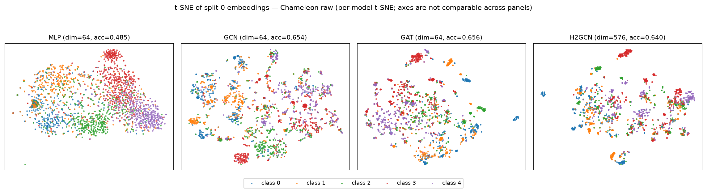

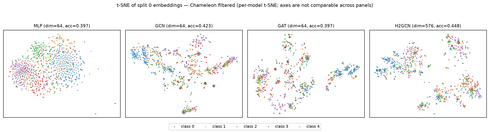

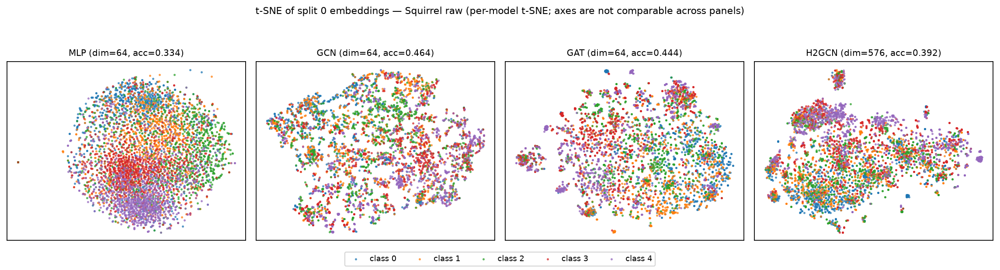

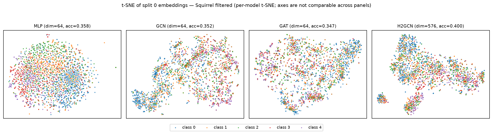

| Condition | Model | Embedding dim | 10-NN label agreement | Silhouette |
|---|---|---|---|---|
| Chameleon / raw | MLP | 64 | 0.592 | +0.047 |
| Chameleon / raw | GCN | 64 | 0.567 | −0.049 |
| Chameleon / raw | GAT | 64 | 0.604 | −0.014 |
| Chameleon / raw | H2GCN | 576 | 0.648 | −0.024 |
| Chameleon / filtered | MLP | 64 | 0.448 | +0.030 |
| Chameleon / filtered | GCN | 64 | 0.410 | −0.006 |
| Chameleon / filtered | GAT | 64 | 0.398 | −0.005 |
| Chameleon / filtered | H2GCN | 576 | 0.429 | −0.002 |
| Squirrel / raw | MLP | 64 | 0.400 | −0.002 |
| Squirrel / raw | GCN | 64 | 0.394 | −0.064 |
| Squirrel / raw | GAT | 64 | 0.428 | −0.033 |
| Squirrel / raw | H2GCN | 576 | 0.451 | −0.074 |
| Squirrel / filtered | MLP | 64 | 0.383 | +0.002 |
| Squirrel / filtered | GCN | 64 | 0.341 | −0.049 |
| Squirrel / filtered | GAT | 64 | 0.301 | −0.038 |
| Squirrel / filtered | H2GCN | 576 | 0.374 | −0.021 |
| Actor / raw | MLP | 64 | 0.354 | −0.013 |
| Actor / raw | GCN | 64 | 0.252 | −0.050 |
| Actor / raw | GAT | 64 | 0.238 | −0.032 |
| Actor / raw | H2GCN | 576 | 0.304 | −0.030 |
| Actor / filtered | MLP | 64 | 0.353 | −0.012 |
| Actor / filtered | GCN | 64 | 0.255 | −0.070 |
| Actor / filtered | GAT | 64 | 0.240 | −0.033 |
| Actor / filtered | H2GCN | 576 | 0.306 | −0.034 |

*Split-0 representations. The 10-NN label agreement is the fraction of the ten
nearest neighbours (standardised embedding space, Euclidean) sharing the node label;
the silhouette is computed on at most 2 000 nodes. Both are computed by
`viz.tsne_plotter.embedding_quality` and stored in
`results/analysis/embeddings_index.json`.*

*Reading.* Silhouette values are close to zero (−0.074 to +0.047) for every model
and condition: the class structure is not captured by globally separated clusters,
which is consistent with strong heterophily and modest absolute accuracies. The
local 10-NN agreement orders the models in the same way as test accuracy in most
conditions — on Chameleon raw GAT (0.604) and H2GCN (0.648) exceed the MLP (0.592);
on Actor the MLP (0.354) is clearly above GCN (0.252) and GAT (0.238). H2GCN has the
highest local agreement on raw Chameleon/Squirrel yet not the best accuracy, so local
neighbour purity alone does not explain classification performance. The t-SNE panels
are a qualitative complement to these numbers: t-SNE neither proves oversmoothing
nor establishes model superiority, and inter-cluster distances are not meaningful.


---

## 10. Discussion

**1. Does graph structure improve performance over the MLP?**
On the original benchmarks, yes, decisively: +8.8 to +13.1 accuracy points for every
graph model on Chameleon and Squirrel raw (all p < 0.0001 after Holm). On the
duplicate-audited data the answer changes: four of six graph/condition combinations
are statistically indistinguishable from the MLP, GCN is slightly worse on both
filtered datasets, and on Actor GCN/GAT are 5.4–6.1 points *worse*. The defensible
statement is conditional: **graph structure helps on the raw benchmarks largely
because of leakage, and its genuine contribution after auditing is small and
dataset-specific.**

**2. When does GCN help or hurt?**
GCN is the model whose behaviour changes most. It gains +12–13 pp on raw
Chameleon/Squirrel (d_z = 4.5–5.7), is neutral on filtered Chameleon/Squirrel
(−1.7 and −0.1 pp) and significantly negative on Actor (−5.4/−5.7 pp). Aggregation
adds value only when neighbourhoods carry label information beyond the features;
when heterophily is high and the graph is uninformative (Actor: average degree 7,
26 % duplicate features), symmetric normalisation washes out the ego-feature signal.

**3. Does GAT differ from GCN?**
Attention gives no systematic advantage. GAT is +0.7 pp above GCN on raw Chameleon,
−3.1 pp below on raw Squirrel, slightly worse on Actor and within 1 pp on filtered
data. Learned attention does not recover information that is absent from the
neighbourhood: under heterophily, *which* neighbours to weight matters less than the
fact that most of them belong to other classes.

**4. Does H2GCN benefit from higher-order neighbourhoods?**
H2GCN is the most robust graph model on audited data: +3.76 pp on Chameleon filtered
(Holm p = 0.129), +3.15 pp on Squirrel filtered (Holm p = 0.006) and on par with the
MLP on Actor (+0.55 pp, n.s.). The ablations in section 8 show that this gain does
**not** come from the exact two-hop branch: removing it changes accuracy by at most
1.2 pp and is never significant, whereas removing the one-hop branch costs 10.6 pp
(Chameleon raw) and 5.8 pp (Squirrel raw). The exception is Squirrel filtered, where
the two-hop-only variant is 1.33 pp better than the full model (Holm p = 0.048). The
price of the wide representation is a 2.4–2.7 F1-point deficit relative to the MLP on
Actor: H2GCN preserves accuracy by favouring frequent classes, not by solving class
imbalance.

**5. What changes after filtering?**
Filtering removes most of the apparent value of message passing. Accuracy drops by
19–27 pp for the three graph models on Chameleon and by 4–12 pp on Squirrel, while
the MLP changes by −12.5 pp on Chameleon and +1.5 pp on Squirrel. The ranking also
changes: GAT is best on raw Chameleon, H2GCN is best on filtered
Chameleon/Squirrel. This reproduces, with a different implementation and protocol,
the central observation of Platonov et al. (2023): conclusions drawn on the raw
Chameleon/Squirrel benchmarks do not transfer to the audited versions.

**6. How significant is duplicate leakage?**
For feature-identical nodes, 14.45 % (Chameleon raw), 4.21 % (Squirrel raw) and
22.34 % (Actor) of test nodes have an exact training duplicate. Upstream filtering
reduces but does not eliminate it (10.81 % and 5.83 %) because Platonov et al.
define duplicates by target *and* neighbourhood, not by identical features. Actor
was never filtered and carries the largest leakage in our grid. Our numbers are a
lower bound on leakage: we require exact feature equality, not neighbourhood
equality.

**7. Are the results consistent across datasets?**
No. The sign of the Structural Delta differs between datasets and conditions
(+12 pp on raw Chameleon/Squirrel, −5 to −6 pp on Actor, ≈ 0 on filtered
Chameleon/Squirrel). A claim of the form "GNNs help/hurt under heterophily" based on
a single dataset is not supported by this grid.

**8. Are the improvements statistically significant?**
On raw data, yes: all nine comparisons survive Holm correction with very large
effect sizes. On filtered data only H2GCN on Squirrel filtered is significant in
accuracy; GAT on Squirrel filtered is significantly *worse* in macro-F1, and all
three models are significantly worse than the MLP in macro-F1 on Actor.

**9. Are the improvements practically meaningful?**
The raw-data gains (+12 pp) are. The filtered-data gains (≤ 3.15 pp, comparable to
the between-split SD) are marginal, and on Actor the negative deltas (−5 to −6 pp
accuracy, −10 to −12 F1 points) are practically important failures rather than
noise.

**10. What remains unexpected?**
(i) MLP accuracy on Chameleon filtered (0.376) is far below Chameleon raw (0.501)
although the retained features are identical: removing duplicate nodes removes easy
test nodes and lowers every model's accuracy. (ii) GAT's macro-F1 on Squirrel
filtered (0.189) is much lower than its accuracy (0.344), a majority-class collapse
that accuracy hides. (iii) The H2GCN accuracy/F1 split on Actor suggests that the
wide concatenated representation favours frequent classes.


---

## 11. Limitations

* **Dataset representativeness.** Three small/medium heterophilous benchmarks from
  two sources (Wikipedia pages, film co-occurrence) cannot represent "heterophily"
  as a whole. They have near-zero adjusted homophily, which makes them adversarial
  for aggregation; the conclusions should not be extrapolated to graphs with moderate
  heterophily or with label-informative neighbour structure.
* **Split comparability.** Raw and filtered Chameleon/Squirrel contain different
  node populations, and Actor raw/filtered use different masks on the same graph.
  Cross-condition differences are therefore descriptive; only within-condition,
  same-split comparisons are tested.
* **Preprocessing deviations.** `actor/filtered` is a custom reproduction with
  stratified splits and no duplicate removal (no upstream filtered Actor file
  exists). The exact Geom-GCN files are used for all `raw` conditions.
* **H2GCN is a principles implementation.** Row-normalised diffusion, one dropout on
  the concatenation and a linear classifier; it is not a bit-exact reproduction of
  Zhu et al. (2020) and may differ from published numbers.
* **Statistical limitations.** Ten splits give limited power; the smallest
  attainable Wilcoxon p-value is 0.002 and Holm correction over 18 tests is
  conservative. Effect sizes are conditional on this protocol. Raw p-values below
  0.05 that do not survive correction are reported as non-significant.
* **Randomness.** Seeds are fixed per split and shared across models and the code is
  deterministic on the dense CPU paths, but sparse scatter reductions in PyTorch are
  not guaranteed to be bitwise reproducible across builds, so exact reruns may differ
  in the last digits.
* **Hardware.** CPU-only, four physical cores; all 320 runs took ≈ 3 h of wall time.
  A larger budget would allow more splits, more seeds and repeated initialisations
  per split.
* **Metric scope.** Accuracy and macro-F1 only; no calibration, robustness or
  fairness analysis. On imbalanced Actor the two metrics disagree substantially.
* **Embedding analysis.** t-SNE is a stochastic projection computed per model; panel
  axes are not comparable and visual cluster separation is not a proof of
  oversmoothing. The kNN/silhouette diagnostics partially mitigate this but are
  themselves computed in the standardised embedding space. Only t-SNE is used:
  UMAP would require an additional dependency (`umap-learn`) that is not part of the
  pinned environment.
* **PDF.** No LaTeX/Pandoc toolchain is installed in the pinned environment, so the
  report is delivered as Markdown (see section 14).

---

## 12. Conclusion

Within a single fixed protocol, 240 primary runs and 80 ablation runs show that the
large advantage of graph neural networks on the classic heterophily benchmarks is
fragile. On the original Geom-GCN splits every graph model beats the structure-blind
MLP by 8.8–13.1 accuracy points with very large paired effect sizes. After the
duplicate audit of Platonov et al. (2023) the advantage largely disappears: GCN and
GAT are statistically indistinguishable from the MLP on filtered Chameleon/Squirrel,
GAT is significantly worse in macro-F1 on Squirrel filtered, and on Actor — where
26 % of nodes have a feature-identical twin — GCN and GAT lose 5–6 accuracy points
and 10–12 F1 points relative to the MLP.

H2GCN is the only graph model that remains competitive on audited data: it is the
best model on filtered Chameleon and Squirrel and accuracy-neutral on Actor, although
its macro-F1 on Actor is significantly below the MLP. The ablations show that this
gain comes from ego-preservation and first-order diffusion rather than from the exact
two-hop branch, which contributes nothing measurable except on Squirrel filtered;
removing the one-hop branch costs 10.6 and 5.8 accuracy points on raw
Chameleon/Squirrel.

The practical conclusions are: (i) always report an MLP baseline; (ii) audit
duplicate nodes before drawing conclusions about heterophily; (iii) prefer
ego-preserving architectures such as H2GCN when structure is used at all; and
(iv) treat accuracy and macro-F1 jointly, because aggregation can silently collapse
minority classes.


---

## 13. References

1. Zhu, J., Yan, Y., Zhao, L., Heimann, M., Akoglu, L., Koutra, D. (2020).
   *Beyond Homophily in Graph Neural Networks: Current Limitations and Effective
   Designs.* NeurIPS 2020. arXiv:2006.11468.
2. Platonov, O., Kuznedelev, D., Diskin, M., Babenko, A., Prokhorenkova, L. (2023).
   *A Critical Look at the Evaluation of GNNs under Heterophily: Are We Really
   Making Progress?* ICLR 2023. arXiv:2302.11640. Data:
   `https://github.com/yandex-research/heterophilous-graphs` (revision
   `a431395582e929d88271309716bea4fe24ce6318`).
3. Pei, H., Wei, B., Chang, K. C.-C., Lei, Y., Yang, B. (2020). *Geom-GCN: Geometric
   Graph Convolutional Networks.* ICLR 2020. Data: Geom-GCN repository (revision
   `f1fc0d14b3b019c562737240d06ec83b07d16a8f`).
4. Kipf, T. N., Welling, M. (2017). *Semi-Supervised Classification with Graph
   Convolutional Networks.* ICLR 2017.
5. Veličković, P., Cucurull, G., Casanova, A., Romero, A., Liò, P., Bengio, Y.
   (2018). *Graph Attention Networks.* ICLR 2018.
6. Lim, D., Hohne, F., Li, X., Huang, S. L., Gupta, V., Bhalerao, O., Lim, S.-N.
   (2021). *Large Scale Learning on Non-Homophilous Graphs: New Benchmarks and
   Strong Simple Methods.* NeurIPS 2021.
7. Rozemberczki, B., Allen, C., Sarkar, R. (2021). *Multi-scale Attributed Node
   Embedding.* Journal of Complex Networks 9(2).
8. Fey, M., Lenssen, J. E. (2019). *Fast Graph Representation Learning with PyTorch
   Geometric.* ICLR Workshop. Documentation:
   `https://pytorch-geometric.readthedocs.io`.
9. Paszke, A. et al. (2019). *PyTorch: An Imperative Style, High-Performance Deep
   Learning Library.* NeurIPS 2019.
10. Pedregosa, F. et al. (2011). *Scikit-learn: Machine Learning in Python.* JMLR
    12:2825–2830.
11. Virtanen, P. et al. (2020). *SciPy 1.0: Fundamental Algorithms for Scientific
    Computing in Python.* Nature Methods 17:261–272.
12. van der Maaten, L., Hinton, G. (2008). *Visualizing Data using t-SNE.* JMLR
    9:2579–2605.

---

## 14. AI-use statement and PDF

**AI use.** The implementation, experiment execution, statistical analysis and the
first draft of this report were produced with the assistance of an AI coding
assistant (Cline). Every numeric result in this report was generated by the code in
this repository and copied from the committed artifacts
(`results/results.json`, `results/ablation_results.json`, `results/analysis/*.csv`,
`reports/tables/*.md`); no result was invented or hand-edited. The datasets, model
architectures and statistical procedures follow the cited literature. The author is
responsible for reviewing the code, the analysis and the conclusions.

**PDF.** The pinned environment contains a CPU-only Python stack without a LaTeX or
Pandoc toolchain (`pandoc` is not installed), so no PDF was generated. The complete
report is delivered as `reports/FINAL_REPORT.md`; converting it requires
`pandoc reports/FINAL_REPORT.md -o reports/FINAL_REPORT.pdf` on a machine with
Pandoc and a PDF engine.

